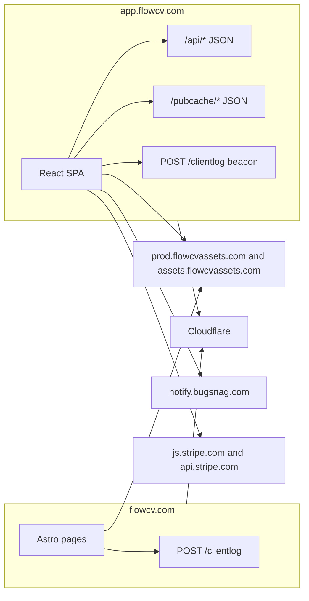
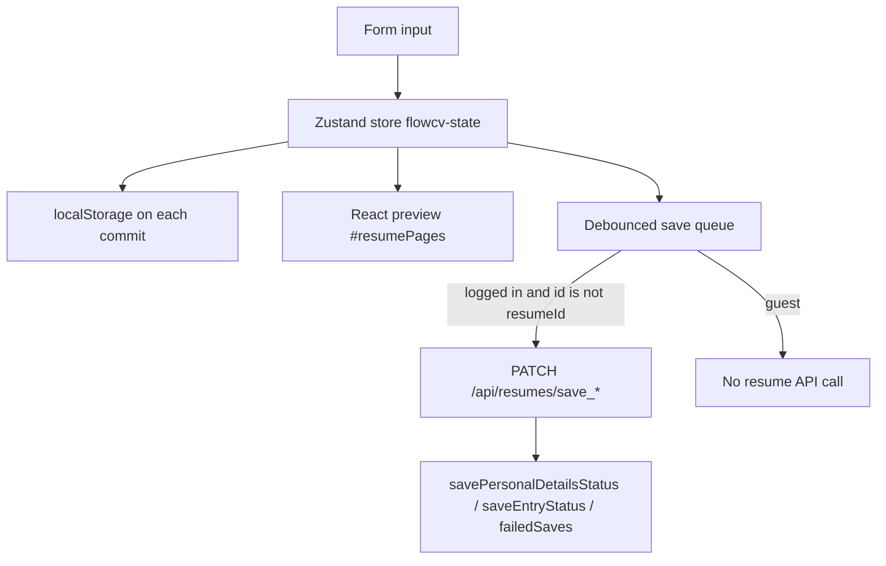
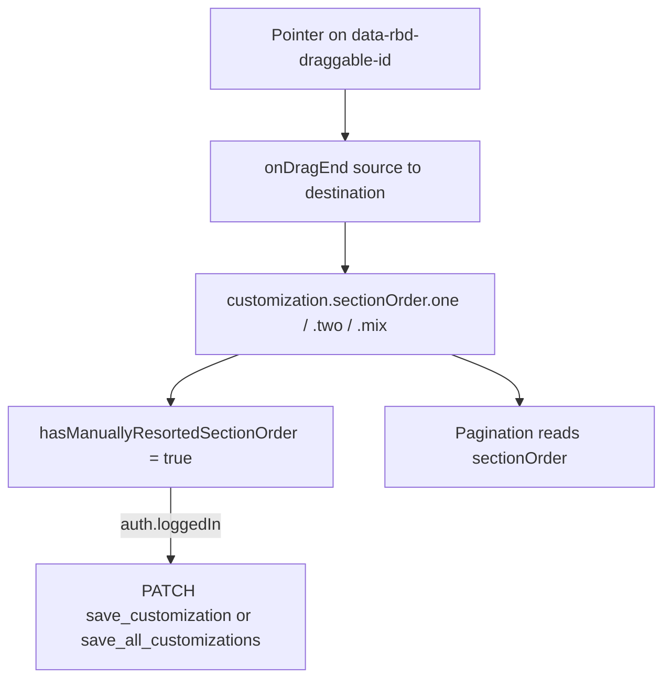
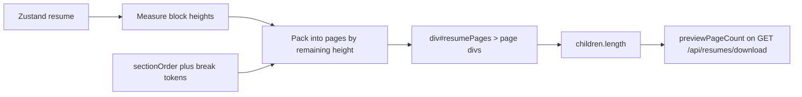

# FlowCV architecture

Captured on 2026-10-22 from the public site as a normal visitor. No account was created. Signup is gated by Google or email plus a Cloudflare Turnstile widget, so the logged-in save and PDF paths were not executed. Those paths are described from the app bundle and marked as static evidence.

Two origins:

| Origin | What it is |
| --- | --- |
| `https://flowcv.com/` | Marketing site. Astro. |
| `https://app.flowcv.com/` | Resume builder. Vite-style React SPA. Guest use works through `/resumes` → `/resume/content`. |

Company line on the marketing page: “© 2026 Uniqkorn Creative GmbH”, described in the page as indie developers in Austria.

Screenshots live in `docs/evidence/screenshots/`. Trimmed request lists live in `docs/evidence/network/scenario-requests.json`. Short source slices live in `docs/evidence/bundle-excerpts.md`.

## How to read the labels

- **Observed.** A REA Evidence record, a Playwright run, or a response body we fetched.
- **Static.** A string or call shape in a public bundle. The bundle was not executed by REA's analyzer (that command ran out of memory). Reading the file does not prove the branch runs for every user.
- **Inference.** A conclusion that goes past the evidence. Called out in its own sentences.

---

## 0. Stack, routing, and session

### Marketing site (observed)

REA `analyze-web-bundle` on `https://flowcv.com/` (evidence `ev_4654d27dcf8b906edc7fc512fee14faac8679fac53bc97218eda86c0929fbf0d`) saw four scripts and one static import:

- `/_astro/PageLayoutParent.astro_astro_type_script_index_0_lang.Cabco4Co.js` imports `./trackEvent.o7Gp2dCf.js`
- Cloudflare `email-decode.min.js`
- an inline script on the document

Styles are `/_astro/*.css`. Fonts are self-hosted `/fonts/dmsans-*.woff2`. Images come from `https://assets.flowcvassets.com`. The HTML is server-rendered (a scenario response body is a full document, not an empty SPA shell). “Get started” links to `https://app.flowcv.com/resumes`. Login links to `https://app.flowcv.com/login`.

A scenario (evidence `ev_53bef98a132c533601463218c20e6a409936bf6cf1bb3fe1edfc2aaa352d983f`) recorded `POST https://flowcv.com/clientlog` twice, both `200`. Local and session storage on this origin were empty at inspect time.

### App shell (observed + static)

Opening `https://app.flowcv.com/resumes` without an account stays on that URL and renders “Start building your resume” (REA scenario `ev_d4b7f63d8de095a04ad2d744669eec65b45f5aa1c3b7dd8ca848f7d58e714deb`). The document loads:

- `/assets/index-76c0f4b1.js` (app)
- `/assets/vendor-3446ddb3.js` (vendor)
- `/assets/index-11e1b4cc.css`

The app chunk is an ES module (`import … from "./vendor-3446ddb3.js"`) and mounts on `#root` with a `createRoot().render` call. The vendor chunk contains React Router's `RouterProvider` (`react-router-dom`). **Inference:** the app is a Vite build with a manual `vendor` chunk. The file layout matches Vite; the repo was not seen, so the bundler name is an inference from the layout and the ESM import.

CSS `@font-face` rules embed **DM Sans** from `/fonts/dmsans-*.woff2`, plus Roboto and “Just Another Hand”. The resume customization default is a different family: `font.fontFamily = "Source Sans Pro"` (static, and confirmed in the guest store below). UI chrome and the resume canvas do not share one font.

Guest routes reached in the browser:

| URL | Screen |
| --- | --- |
| `/resumes` | Template picker. “Create resume now”. |
| `/resume/content` | Editor shell: Overview, Content, Customize, AI Tools, Download, Add Content. |
| `/resume/content/edit/personal-details` | Personal details form. |
| `/resume/content/edit/work/<uuid>` | Experience entry. |
| `/resume/content/edit/education/<uuid>` | Education entry. |
| `/resume/customization` | Layout, type, color, section order. |
| `/resume/ai-tools` | Linked in the nav. Not opened. |
| `/cover-letters`, `/job-tracker` | Linked from the picker nav. Not opened. |

Further paths that appear as string literals in the app chunk include `/login`, `/signup`, `/resume/download`, `/settings`, and `/pricing`. Those strings are static route candidates, not a proof that each one was visited.

### Auth and session (observed + static)

`GET /api/auth/init_user` returns, for a logged-out browser:

```json
{"success":true,"data":{"user":null,"currentPlan":"free"},"error":"","code":200}
```

REA scenario evidence `ev_c5937865a1fc84ae68707aec78583511f4f651ce8c63c0665c40dac1de98afa8`. The same envelope (`success`, `data`, `error`, `code`) wraps `GET /pubcache/published-resume-templates`.

Response headers on the app include `server: cloudflare`, `cf-ray`, `cf-cache-status`, and `x-ratelimit-*`. `Set-Cookie` sets `appVersion` to a 40-hex build id and the page also sets a cookie named `i18n`. REA storage capture hashed both values and did not return them.

The guest Zustand snapshot (Playwright, see below) has `auth.loggedIn: false` and flags for Google link errors, login/signup/reset modals, and `signupToDownloadMsg`. Static auth routes include `/api/auth/login`, `/api/auth/signup`, `/api/auth/logout`, `/api/auth/google/init`, `/api/auth/google/disconnect`, password reset, email verification, and `/api/auth/verify_captcha_token`. The signup UI renders Cloudflare Turnstile (`window.turnstile.render("#turnstile-container", …)`). A `recaptchaOptions` nonce hook is also present. **Observed UI:** the download dialog offers “Continue with Google” and “Sign up with Email” (REA evidence `ev_3b4653db0ccfbb3af816358f2351058ada6463733a500b6c03d8ed46ca526784`).

### Content-Security-Policy (observed)

From the `init_user` response headers in that same REA capture, abbreviated:

- `script-src` allows `'self'`, `https://js.stripe.com`, `https://www.gstatic.com`, a nonce, `'unsafe-eval'`, `*.stripe.com`, `https://challenges.cloudflare.com`
- `connect-src` allows `'self'`, both FlowCV origins, `https://notify.bugsnag.com`, asset hosts, and Stripe
- `frame-src` allows Stripe, YouTube, and Cloudflare challenges
- `img-src` allows FlowCV asset hosts, Unsplash, and `https://assets.grammarly.com`

Grammarly is allowed as an image host. The string `grammarly` does not appear in the two JS bundles, so this is a CSP permission, not proof the app embeds Grammarly.



---

## 1. Data architecture

**Answer.** Guest text is held in a Zustand store with the `persist` middleware and written to `localStorage` under the key `flowcv-state`. It is not posted to the API while the resume id is the local sentinel and the user is logged out. Logged-in edits are debounced `PATCH`es. Redux is in the vendor chunk; the resume document itself is the Zustand store.

Confidence: **high** for the guest path (runtime store plus zero resume API calls). **High** that logged-in saves are debounced HTTP patches (static call sites). **Not executed,** because signup was not completed.

### Runtime store (Playwright)

After “Create resume now”, `localStorage["flowcv-state"]` parsed as:

```text
{ state: { auth, user, resume, letter, website, signature, tracker }, version: 0 }
```

About 11 KB for an empty guest resume. `state.resume.selectedResumeId` was the string `"resumeId"`. `state.resume.resumes[0]` included `id`, `title` (`"Resume 1"`), `lng` (`"en_US"`), `personalDetails`, `content`, `customization`, `downloads`, `mongoId`, `userId`, `schemaVersion`, and web-resume fields. `auth.loggedIn` was `false`. `user.user` was `null` from `init_user`, while the persisted slice still has a user *shape* (email, plan, AI credits, consent versions). `user.unlockedFeatures` lists `resumes`, `hasUnlimitedResumes`, `letters`, `hasUnlimitedLetters`, `tracker`, `signature`, `website`, and one-time payment flags. That object is the product gate in the client. No LaunchDarkly, GrowthBook, or Unleash string was found. The `featureFlags` text in the vendor chunk is Bugsnag's config validator, not a flag service.

`content` starts as `{}`. Adding sections created keys `work` and `education`:

```text
work:      { sectionType: "work", displayName: "Professional Experience", entries: [ { id, isHidden, isNewEntryToSave, showPlaceholder, employer, employerLink, jobTitle, ... } ] }
education: { sectionType: "education", displayName: "Education", entries: [ { id, isHidden, isNewEntryToSave, showPlaceholder, ... } ] }
```

Personal detail fields in the live object match the form `name`s: `fullName`, `jobTitle`, `displayEmail`, `phone`, `address`, plus many optional keys (`nationality`, `visa`, `birthday`, `photo`, `social`, …). `detailsOrder` defaulted to `["displayEmail", "phone", "address"]`.

IndexedDB names and the Cache Storage list were empty on the marketing origin. On the app origin, REA's storage capture (scenario `ev_d4b7f63d8de095a04ad2d744669eec65b45f5aa1c3b7dd8ca848f7d58e714deb` and the later create scenario) showed localStorage keys `bugsnag-anonymous-id` and `flowcv-state` only. The hash of `flowcv-state` changed after “Create resume now”, which is consistent with a local write. REA does not return the value; Playwright did.

### What the network did while typing (Playwright)

Creating a resume, filling the name, and waiting 6 seconds produced one API call: `GET /api/auth/init_user`. No `PATCH` or `POST` to `/api/resumes/*`. `savePersonalDetailsStatus` and `saveEntryStatus` stayed `"idle"`. The preview text updated in the same turn as the inputs.

### Static save pipeline

The store is created with Zustand's persist middleware, name `"flowcv-state"`, and `localStorage` when `Al()` is true (otherwise a no-op storage). Several slices are merged into one store. Immer is in the vendor chunk (`Symbol.for("immer-nothing")`). **Inference:** the `B(...)` wrapper around the store creator is Immer's middleware, because the call sits between `persist` options and the slice merger. That is a structural inference, not a named import.

Server sync, from the app chunk:

| Action | Call | Cadence | Guard |
| --- | --- | --- | --- |
| Personal details | `PATCH /api/resumes/save_personal_details` `{ resumeId, personalDetails }` | debounced; a nearby debounce is 5 s with `maxWait` 10 s | sets `savePersonalDetailsStatus` |
| Entry order | `PATCH /api/resumes/save_entries_order` `{ resumeId, sectionId, newEntriesIdsOrder, disableAutoSort }` | `debounce(..., 1000)` | `if (resume.id === "resumeId") return` |
| Section title | `PATCH /api/resumes/save_section_name` | 500 ms timeout | one site checks a logged-in flag before calling |
| Section icon | `PATCH /api/resumes/save_section_icon` | immediate | returns early when `!auth.loggedIn` and only updates the store |
| All customizations | `PATCH /api/resumes/save_all_customizations` | debounced 1 s | `if (!auth.loggedIn) return` |
| One customization | `PATCH /api/resumes/save_customization` `{ customizationUpdates, resumeId }` | on the design path, with a 1 s retry list | failure rolls the cached value back and toasts |

Axios (`za` / `fm`) is the HTTP client. Failures can be pushed onto `resume.failedSaves`.

**Inference:** `"resumeId"` is the unsaved guest id, so the entry-order request is skipped until the server assigns a real id. The personal-details function does not show that same sentinel check in the slice we read. The runtime still sent nothing, so either the queue is not armed for guests or another guard sits outside the excerpt. We did not see a guest `PATCH`.



---

## 2. Drag-and-drop and layout order

**Answer.** The editor's section list uses the react-beautiful-dnd DOM contract (`data-rbd-draggable-id`, `data-rbd-droppable-id`) and an `onDragEnd({ source, destination, draggableId })` callback. Order is stored on `customization.sectionOrder`, not as a single array. Template-admin grids use `react-sortablejs` instead. A logged-in customization change is a debounced `PATCH`.

Confidence: **high** for the attribute contract and the state shape. **Medium** for the exact npm package, because the minified bundle does not contain the strings `react-beautiful-dnd` or `@hello-pangea/dnd`. Both libraries emit `data-rbd-*`. **Not observed:** a drag that actually changed the order. One Playwright mouse drag did not.

### DOM (Playwright)

With Experience and Education added, `#sectionOrderDesign` rendered:

```text
Change Section Layout
Personal Details
Professional Experience
Education
Page break
```

`[data-rbd-draggable-id]` values were `work`, `education`, and `break`. The droppable id was `droppable-1`. Personal Details was visible but was not one of those draggable ids.

### State shape (Playwright, after adding two sections, before a successful drag)

```json
{
  "one": { "sectionsSorted": ["work", "education"] },
  "two": {
    "leftSectionsSorted": ["work"],
    "rightSectionsSorted": ["education"]
  },
  "mix": [{ "left": ["work"], "right": [] }, "education"]
}
```

`layout.detailsPosition` was `"top"`. `layout.colsFromDetails` maps `top → one`, `left → two`, `right → two`. The customize screen exposes column modes **One**, **Two**, and **Mix**, which match those three keys. `hasManuallyResortedSectionOrder` defaults to `false` and the drag handler sets it when it writes `sectionOrder`.

`content[sectionId].entries` is a separate order. Reordering entries sets `disableAutoSort` and, unless the id is `"resumeId"`, patches `save_entries_order`.

### Two libraries (static)

- Editor and several other lists (resume tags, letter tags, job-tracker columns) call `onDragEnd` and render `droppableId` children. The vendor chunk has dozens of `Droppable` / `Draggable` / `draggableId` hits and no package-name string.
- Template management uses `gl.ReactSortable`. The vendor chunk includes `react-sortablejs` and the SortableJS readme URL. Those call sites are the template grid, not `#sectionOrderDesign`.



---

## 3. Live preview

**Answer.** The preview is HTML in the same document as the form, rendered by the same React tree. It is not an iframe, not a canvas, and not a PDF.js re-render of the download file. Pagination is a custom height packer that writes one child per page under `#resumePages`.

Confidence: **high**.

### Binding (Playwright)

After filling the personal form, `#resumePages` existed in the main document:

| Property | Value |
| --- | --- |
| Child count | 1 |
| Container size | `816px` × `1088px` |
| First child | a `DIV`, `816px` × `1056px` |
| Text | `Ada Lovelace`, `Mathematician`, email, phone, `London, UK` |

US Letter at 96 CSS pixels is 8.5×11 in = **816 × 1056**. The child matches the page. The customization control at the same time said page format **Letter (US & Canada)** and `customization.pageFormat` was `"Letter"`. The locale table in the bundle sets `en_US.pageFormat` to `"Letter"` and most other locales to `"A4"`. The design default object starts as `"A4"` and is overwritten from the locale when a resume is created.

Adding Experience and Education appended their headings to `innerText` on the next read, still one page, with no resume API traffic. The form and the preview were both in `document`, so this is one React tree, not `postMessage` into an iframe. The only `iframe` hit in the app chunk is a “is this element empty?” selector list (`img, svg, video, …, iframe, canvas`), not a preview frame.

### Packer (static)

`#resumePages` maps an array of pages to React elements. Each page is a list of blocks. Blocks have `kind` (`"pagebreak"`, `"heading"`, `"spacer"`, section content) and a measured `height` (`onHeightChange`). The packer keeps a running height per column and starts a new page when the next block does not fit. Two-column pages store `leftCol` and `rightCol`. Explicit `"break"` tokens in `sectionOrder` become page-break blocks. The customize UI includes a “Page break” row in the section list, and the draggable id `break` was present.

The download code reads `document.getElementById("resumePages").children.length` and sends it as `previewPageCount`. The server is told how many pages the client packer produced. **Inference:** the server print layout is meant to agree with that count, but we never received a PDF to compare.



### Pseudocode of the data-to-canvas loop

This is reconstructed from the bundle's control flow and from the DOM measurements. It is not a decompilation.

```text
function renderPreview(state):
  resume = state.resume.resumes.find(id == state.resume.selectedResumeId)
  locale = localeTable[resume.lng]          # en_US -> Letter, 816 x 1056
  pageHeight = pageSize[resume.customization.pageFormat].height
  blocks = []
  for sectionId in activeOrder(resume.customization):
    if sectionId contains "break":
      blocks.push({ kind: "pagebreak", height: 0 })
      continue
    section = resume.content[sectionId]
    blocks.push(headingBlock(section.displayName))
    for entry in section.entries:
      blocks.push(entryBlock(entry))        # height comes from layout measurement
    blocks.push(bottomSpaceBlock)
  pages = pack(blocks, pageHeight)          # new page when cursor + block.height > pageHeight
  return <div id="resumePages">{pages.map(page => <Page blocks={page} />)}</div>

function onFieldChange(path, value):
  setInZustand(path, value)                 # preview re-renders immediately
  persist flowcv-state to localStorage
  if not logged in or resume.id == "resumeId":
    return
  debounce(1000 to 5000 ms, () => patch("/api/resumes/save_*", payload))
```

---

## 4. PDF generation

**Answer.** The file is produced on the server. The client downloads it as an Axios blob and saves it with FileSaver. Guests never reach that request: Download opens an account dialog, and REA recorded no `/api/resumes/download` call.

Confidence: **high** that the client treats the response as a PDF blob from `GET /api/resumes/download`. **High** that guests are blocked before the call. **Unknown** which server engine writes the bytes (headless Chrome, a PDF library, or something else). No file was downloaded, so Producer/Creator metadata was not read.

### Static client (app chunk)

```text
if not logged-in email path:
  show download modal or, on iPhone, route to /resume/download
  pageCount = #resumePages.children.length
  response = GET /api/resumes/download?resumeId=&previewPageCount=   (blob, retries at 4s and 8s)
  wait until at least 6 seconds have passed
  saveAs(new Blob([response.data], { type: "application/pdf" }), filename + ".pdf")
```

There is a sibling `POST /api/resumes/download_via_email` that returns immediately when `!auth.loggedIn`. Strings for `pdfmake`, `jsPDF`, `@react-pdf/renderer`, `pdf-lib`, and `html2canvas` were not in either bundle. `application/pdf` in the app chunk is this blob type plus the import-file allow-list (`pdf`, `docx`, `doc`, `png`, `jpeg`).

### Observed guest behavior

REA scenario `ev_3b4653db0ccfbb3af816358f2351058ada6463733a500b6c03d8ed46ca526784`:

1. Open `/resumes`.
2. Click “Create resume now” → `/resume/content`.
3. Click “Download”.
4. A dialog appears: “Create account. Save your resume and download unlimited PDFs.” Buttons: “Continue with Google”, “Sign up with Email”.
5. The scenario's request list contains no `/api/resumes/download`.

Screenshot: `docs/evidence/screenshots/11-download-gate-rea.png`.

**Inference:** production PDFs are rendered by a backend worker that receives the resume id and the client page count. The CSP `connect-src` does not include a third-party PDF host, so the worker is same-origin (`app.flowcv.com`) or reached through that origin. Headless Chrome is a common way to reprint HTML, and the client already has an HTML page tree plus a page count, but the worker source was not visible. Do not treat “Puppeteer” as a finding.

---

## 5. Template and theme system

**Observed.** The picker loads `GET /pubcache/published-resume-templates` (`200`, `application/json`, Cloudflare `HIT`). The body is `{ success, data: { templates }, error, code }` with **109** templates. The first object, “Classic Clear” (`slug: classic-clear`), includes `id`, `publicId`, `title`, `heading`, `slug`, `tags` (for example `["simple"]`), `isPremium`, `experienceLevel`, `images`, `content`, `contentWithoutEntries`, `placeholderContent`, `personalDetails`, and `customization`.

Customization keys on that record include `font`, `colors`, `layout`, `spacing`, `header`, `entryLayout`, `pageFormat`, `heading`, `advanced`, `background`, `border`, language-specific fonts (`arabicFont`, `hebrewFont`).

The guest resume's own `customization` (Playwright) had the same family of keys: `layout`, `sectionOrder`, `spacing` (`marginVertical`, `marginHorizontal`, `fontSize`, `lineHeight`, `spacingFactor`, per-role font sizes), `font.selected = "serif"`, `font.fontFamily = "Source Sans Pro"`, `colors`, `header`, `pageFormat`, `educationDisplay`, `workDisplay`, and `hasManuallyResortedSectionOrder`.

The customize screen (Playwright text) exposes language, date format, page format, One/Two/Mix columns, font size in points, 16 mm margins, line height 1.3, heading capitalization, icon style, accent color, header alignment, and “Browse templates”. Applying a template is a static `POST` or similar to `/api/resumes/apply_template` and `/api/resume-templates/get-template`. Those calls were not seen while logged out; the picker itself only downloaded the public cache and images from `https://prod.flowcvassets.com/resume-templates/<id>/480.webp`.

**Inference:** a template is a saved customization plus placeholder content, not a separate render engine. The same packer draws every template.

---

## 6. Resume data model

Guest document, fields we actually saw or that the create-resume function writes:

```text
Resume
  id: "resumeId" until the server assigns one
  uuid, mongoId, userId, schemaVersion
  title, tags, lng, order
  personalDetails: fullName, jobTitle, displayEmail, phone, secondPhone, address,
                   photo, detailsOrder, nationality, birthday, visa, website, social, ...
  content:
    [sectionId]:
      sectionType, displayName, iconKey, disableAutoSort, entries[]
      entry: id, isHidden, isNewEntryToSave, showPlaceholder, plus type fields
        work: jobTitle, employer, employerLink, location, dates, description
        education: degree, school, location, dates
  customization:
    layout, entryLayout, sectionOrder, header, spacing, font, colors,
    pageFormat, date formats, hasManuallyResortedSectionOrder, ...
  downloads[], webResumeLive, webToken, feedback, customizationsHistory
```

Section types offered by “Add Content” (Playwright text): Summary, Education, Professional Experience, Skills, Languages, Certificates, Interests, Projects, Courses, Awards, Organizations, Publications, References, Declaration, Custom. The locale table's `sectionNames` uses the same ids (`profile`, `education`, `work`, `skill`, `language`, …).

This is not the [JSON Resume](https://jsonresume.org/) schema. Names like `work` / `displayEmail` / `sectionOrder.mix` are FlowCV's.

---

## 7. API surface seen or named

### Called while logged out (observed)

| Method | Path | Body / result |
| --- | --- | --- |
| `GET` | `/api/auth/init_user` | `{ user: null, currentPlan: "free" }` |
| `GET` | `/pubcache/published-resume-templates` | 109 templates |
| `GET` | `/pubcache/published-letter-templates` and signature/website variants | named in the bundle; not all were fetched |
| `POST` | `/clientlog` | beacon JSON `{ event, href, referrer, width, props, timestamp }`; response body `OK` |
| `GET` | `/manifest.webmanifest` | name FlowCV, `display: standalone` |

`/clientlog` is `navigator.sendBeacon` when available, otherwise `fetch`. Playwright often reports an empty post body for beacons; the payload shape is from the source.

### Named in the app chunk (static, not all called)

Resume writes: `create`, `all`, `duplicate`, `delete_resume`, `rename_resume`, `save_entry`, `delete_entry`, `delete_section`, `save_language`, `save_tags`, `import_resume`, `fill-resume-with-ai`, `translate`, `upload_profile_pic`, `publish_web_resume`, `download`, `download_via_email`.

Letters, trackers (`/api/trackers/move_card`), websites, signatures, groups, Unsplash search (`/api/unsplash/search`), and AI (`/api/ai/tools/grammar`, `generate-summary`, `improve-writing`, `skills/suggest`).

Payments: `/api/payments/buy`, `create-setup-intent`, `confirm_payment_intent`, `/api/managed-payments/create_checkout_session`, `/api/pricing/info`, `/api/users/cancel_subscription`. Stripe.js is loaded (`loadStripe`, `pk_live_…`).

Admin routes under `/api/admin/resume-templates` are present in the client bundle. They were not called.

---

## 8. Third parties and flags

| Service | Evidence | Role |
| --- | --- | --- |
| Cloudflare | `server`, `cf-ray`, `cf-cache-status`, email-decode script, Turnstile | CDN, bot challenge on auth |
| Bugsnag | console `[bugsnag] Loaded!` from `vendor-3446ddb3.js`; `notify.bugsnag.com` in CSP; localStorage `bugsnag-anonymous-id`; `@bugsnag/plugin-react` in the vendor chunk | Error reporting |
| Stripe | CSP, `loadStripe`, `pk_live_` key, payment routes | Billing |
| YouTube | `frame-src https://www.youtube.com` | Embedded video allowed |
| Unsplash | `img-src https://images.unsplash.com`, `/api/unsplash/search` | Stock photos |
| Google | “Continue with Google”, `/api/auth/google/init` | Login |
| Assets CDN | `prod.flowcvassets.com`, `assets.flowcvassets.com`, CloudFront host `d201kpdrh73vuz.cloudfront.net` in CSP `media-src` | Images and media |
| react-toastify | CSS variable `--toastify-font-family` | Toasts. The failure strings say `La.fail(...)`. |

Not found as product analytics SDKs: `posthog`, `sentry`, `mixpanel`, `segment.com`, `googletagmanager`. The word `amplitude` in the vendor chunk is an SVG attribute name, not the Amplitude SDK. First-party `clientlog` is the event path we saw fire (page views / UI events on the marketing site and the app).

`unlockedFeatures` in the user slice is the in-app feature gate. It is data on the user, not a third-party flag system.

---

## 9. What was not captured

- A logged-in session, a server resume id, or a debounced `PATCH` on the wire. Signup shows Cloudflare Turnstile, and that widget was not completed.
- A PDF file and its Producer/Creator metadata. Guests are stopped before `GET /api/resumes/download`.
- A drag that changed `sectionOrder`. The `data-rbd-*` nodes were present. The scenario schema has no drag action, and one Playwright mouse drag did not take.
- `analyze-web-bundle` on the app origin. That command still runs out of memory. A later `analyze-javascript-application` of the downloaded app chunk did complete; see section 10. The vendor chunk was not passed to that analyzer.
- Source maps. The app and vendor script records report an empty `source_map_url`. None is declared at the end of either file.
- Checkout, AI tool calls, website publish, and email-signature editing. Those routes and payloads are static, or the screen was only opened far enough to read its guest shell.
- Whether Redux is mounted. `redux` and `react-redux` are inside `vendor-3446ddb3.js`. The app chunk never says `redux`. The resume document we read from `flowcv-state` is the Zustand persist shape (`{ state, version }`). **Inference:** Redux is a dependency of something in the vendor graph, or leftover, and is not the resume store.

---

## 10. REA application graph of the app chunk

**Static, REA.** `rea analyze-javascript-application` on a directory that contained only `index-76c0f4b1.js` (2,623,829 bytes). Isolated analyzer heap 2048 MiB, semantic-node cap 25,000. Evidence `ev_73c6595685fe16e1898e36d38331b622f71c2be4bf176962eaf9530115598b60`, confidence `derived`.

| Fact | Value |
| --- | --- |
| AST nodes visited | 453,097 |
| Parsed JavaScript files | 1 |
| Graph nodes retained | 259 (245 `endpoint`, 9 `storage`, 3 `javascript-module`, 1 asset, 1 artifact) |
| Edges | 499 (`calls` 234, `imports` 182, `exposes` 65, `persists_to` 16, `contains` 2) |
| Graph coverage | `partial` |
| Semantic graph | capped; the structural inventory is what the endpoint list comes from |

The same command on the marketing page's small Astro scripts is a different, earlier run. `analyze-web-bundle` against the live app origin is still the OOM in `docs/evidence/rea-analyze-web-bundle-oom.txt`. This local analysis did not execute the bundle.

Two follow-up traces of that Evidence:

| Seed | Evidence | Result |
| --- | --- | --- |
| `{kind:"api", value:"/api/resumes/download", match:"exact"}` | `ev_c4192883bcc3f6f5d711521e2137a26d3c074ed0c699414171f6c6dc6ebc63c4` | 0 matches. REA's limitation text: a miss is not proof the feature is absent. The graph stores the path as an endpoint label under a `literal` identity key, and this seed kind did not bind it. |
| `{kind:"string", value:"/api/resumes/download", match:"exact"}` | `ev_621757900415621a44d786d342a591be10bcd1d17cf2747a217319c8e45b75c6` | 1 seed. Direction `both` then walked all 259 retained nodes and 499 edges. |

**Inference:** that second trace shows the download string is in the retained graph. It does not produce a short caller list, because the retained graph is one module with import edges that connect almost everything, and coverage is still partial.

The full endpoint table is `docs/evidence/rea-endpoint-inventory.txt`. Mechanisms `call:za.get|post|patch|delete` and `call:fm.get` are the two Axios clients in the app chunk. `fm.get` is the blob downloader (`/api/resumes/download` and `/api/letters/download`). A handful of `call:fetch` / `call:navigator.sendBeacon` rows point at minified expressions (`e.href`, `r`) rather than a literal path. Those stay unresolved.

`property:path` rows that do not start with `/` (`entryLayout.colWidths`, `spacing.jobTitleFontSizePt`, and similar) are object paths the route detector also emitted. They are customization fields, not URLs.

Storage facts from the same graph: `localStorage` name `ab_test_overrides` via `getItem`, plus anonymous `getItem` / `setItem` / `removeItem` / `clear` and `sessionStorage` calls whose key expression was not a literal. The only literal A/B test id in the app chunk is `signup_download_subline` (`getVariantForAbTest("signup_download_subline")`). The helper reads `user.user.helper.abVariants[id]` when `auth.loggedIn` is true, and the localStorage override wins when present. **Static.** No LaunchDarkly, GrowthBook, or Unleash string. The product gate that is actually populated on the guest user object remains `unlockedFeatures` (section 1).

---

## 11. Routes

### Observed in a normal guest browser

REA scenario `ev_795c3363d9a3b993c2d439694e5fe58b73ebf59f4e271f579b27708778bbeeb5` loaded each URL and got HTTP 200. A later headed scenario `ev_6cd2fe909c1edf62fb8b579f18f4b4a01af5cad17caa46e1e96069e7a9034558` captured accessibility text and screenshots.

| URL after navigation | What the page showed |
| --- | --- |
| `/resumes` | Template picker. “Start building your resume”, tag filters All / Simple / Modern / Creative, “Import existing resume”, “Create resume now”. Inspect evidence `ev_d7dcc5f1fb9fc17e32fe6af1d29766199d12bec7ec35a192df7068e15b6b027e` (963 accessibility nodes). |
| `/login` | Heading “Login”. Buttons “Continue with Google” and “Login with Email”. Link to `/signup`. Screenshot `12-login.png`. |
| `/signup` | Stayed on `/signup` (HTTP 200). Accessibility was not requested on that step of the headless tour. |
| `/pricing` | HTTP 200, then the client moved to `/plans`. |
| `/plans` | “Choose the plan that fits your job search.” Free is $0 and lists 1 resume, 1 cover letter, unlimited watermark-free PDFs, all templates. Pro yearly shows “$5 /month” and “$60 billed yearly”, with Monthly / Quarterly / Yearly radios. Screenshot `13-plans.png`. |
| `/cover-letters` | “Create a cover letter” and a template grid (Classic Left, Classic Split, …) plus “New blank”. Screenshot `14-cover-letters.png`. |
| `/job-tracker` | Board columns Wishlist, Applied, Interview, Offer, Rejected, each with “Add job”, plus “Add Column”. Copy says the tracker is available in Pro and offers “Upgrade your plan”. Screenshot `15-job-tracker.png`. |
| `/settings` | HTTP 200 in the headless tour. The accessibility snapshot at the end of that run was only the document node, and the screenshot was a few kilobytes, so the settings UI itself was not read. |
| `/resume/content`, `/resume/content/edit/personal-details`, `/resume/content/edit/work/<uuid>`, `/resume/content/edit/education/<uuid>`, `/resume/customization` | Editor, from the earlier guest session in sections 1–3. |

`GET /api/pricing/info` fired when `/plans` loaded. Body (Evidence, 382 bytes): `data.pricing` with `countryCode: "US"` and amounts in cents: `basicV2` 1100 / 3600, `proV2` 1900 / 3600 / 6000, `sig` 3200, `web` 2400, currency `usd`. Saved as `docs/evidence/network/pricing-info.json`. **Inference:** the server picked US from the request, and the on-screen “$5 /month” is `6000 / 12` cents. The plans UI did not show a separate Basic, Signature, or Website price, so those keys are in the payload and not all of them were rendered in the snapshot we read.

The plans page says a free account gets unlimited PDF downloads. The guest Download button still opens “Create account” before any download request (section 4). Those two observations sit together: the unlimited-PDF line is a logged-in free-plan claim, and the anonymous editor does not download.

### Route patterns retained by REA

Under `property:path`, the ones that are paths (static, partial graph):

`/`, `/resumes`, `/resume/*`, `/content`, `/content/edit/personal-details`, `/content/edit/:sectionId/:entryId`, `/customization`, `/download`, `/ai-tools`, `/login`, `/signup`, `/forgot-password`, `/reset-password/:resetToken`, `/pricing`, `/plans`, `/settings`, `/dashboard`, `/cover-letters`, `/cover-letter/*`, `/job-tracker`, `/applications`, `/email-signatures`, `/email-signature/*`, `/websites`, `/website/*`, `/templates`, `/discover`, `/design`, `/write`, `/write/edit/:section`, `/domain`, `/elements`, `/members`, `/connect/:token`, `/s-template/:token`, `/w-template/:token`, `/org/*`, `/student-benefits`, `/manage-resume-templates/*`, `/manage-letter-templates/*`, `/change-gmail-signature`, `/change-apple-mail-signature`, and `*`.

**Inference:** `/resume/*` is the parent, and `/content` and `/customization` are relative children. That matches the URLs we actually opened (`/resume/content`, `/resume/customization`). The catch-all `*` is a router fallback, not a page we opened.

---

## 12. API catalog and payload shapes

### Observed while logged out

Trimmed list: `docs/evidence/network/tour-observed-requests.json` (scenario `ev_795c3363…`).

| Method | Path | Result |
| --- | --- | --- |
| `GET` | `/api/auth/init_user` | `{success, data:{user:null, currentPlan:"free"}, error:"", code:200}` on every route in the tour |
| `GET` | `/api/pricing/info` | Pricing object above. Only after `/plans` |
| `GET` | `/pubcache/published-resume-templates` | 109 templates. Cloudflare cache hit |
| `GET` | `/pubcache/published-letter-templates` | 200 when `/cover-letters` opened. Body not copied into the repo (large) |
| `POST` | `/clientlog` | Response body bytes decode to `OK` |
| `GET` | `/manifest.webmanifest` | 200 |

No `/api/resumes/*` write, and no Stripe or Bugsnag network call, during that tour. Bugsnag still printed `[bugsnag] Loaded!` from `vendor-3446ddb3.js` (console text in the inspect Evidence). The notify host is allowed by CSP and was not contacted in this window.

`inspect-web-event-listeners` on the first `button` (evidence `ev_9df481b1a020a43f5c575af80c7da1d55191033446956ad03efa6279ea85926f`) found one bubbling `click` listener in `vendor-3446ddb3.js` at line 0, column 75394, with an empty source-map URL. **Inference:** that is React's delegated root listener, not a named FlowCV handler. `discover-webmcp-tools` (evidence `ev_493fae58511e97403397d8fd88cbd4db3f3245017078278ae298d94bc9f4795a`) found zero page-declared tools.

### Static call shapes

REA's mechanism column is the HTTP method. The object-literal arguments below are quoted from the app chunk next to those calls. They are the client payload, not a captured request.

| Call | Argument object |
| --- | --- |
| `POST /api/resumes/create` | `{clientResume}` where `clientResume` is a deep clone of the local resume |
| `PATCH /api/resumes/save_personal_details` | `{resumeId, personalDetails}` |
| `PATCH /api/resumes/save_entry` | `{resumeId, sectionId, entry}` |
| `PATCH /api/resumes/save_entries_order` | `{resumeId, sectionId, newEntriesIdsOrder, disableAutoSort}` |
| `PATCH /api/resumes/save_section_name` | `{resumeId, sectionId, displayName}` |
| `PATCH /api/resumes/save_section_icon` | `{resumeId, sectionId, iconKey}` |
| `PATCH /api/resumes/save_customization` | `{customizationUpdates, resumeId}` plus `retry.retriesMs: [1000]` |
| `PATCH /api/resumes/save_all_customizations` | `{resumeId, allCustomizations}` |
| `PATCH /api/resumes/apply_template` | `{customization, resumeId, templateId, content, businessDetails, usingBusinessTemplateId, personalDetails}` |
| `PATCH /api/resumes/save_language` | `{resumeId, lng}` |
| `PATCH /api/resumes/save_tags` | `{resumeId, tags}` |
| `PATCH /api/resumes/rename_resume` | method from the graph; body not in the literal-object slice |
| `PATCH /api/resumes/publish_web_resume` | `{publish, resumeId}` then `GET /api/resumes/preload_web_resume_og_image?webToken=` |
| `GET /api/resumes/download` | query `resumeId`, `previewPageCount`; Axios `responseType: "blob"`; retries at 4s and 8s |
| `POST /api/resumes/download_via_email` | `{resumeId}` |
| `POST /api/letters/create` | `{clientLetter}` |
| `GET /api/letters/download` | query `letterId`, `timeZone`; blob; same retry delays |
| `POST /api/trackers/create` | `{clientTracker}` |
| `POST /api/trackers/move_card` | `{trackerId, cardId, toColId, toIndex, statusUpdateId, changedAt}` |
| `POST /api/trackers/save_columns` | `{columns, trackerId}` |
| `POST /api/managed-payments/create_checkout_session` | `{planCode, durationMonths, billingCountryCode, uiMode:"embedded", returnPath, entryIdToSaveBeforePayment}` |
| `POST /api/auth/login`, `POST /api/auth/signup` | methods from the graph. Bodies were not exercised |

The same `{success, data, error, code}` envelope wraps `init_user`, pricing, and the template cache. **Inference:** that envelope is the app's JSON convention. It was not checked on an error response.

Admin routes under `/api/admin/resume-templates` and `/api/admin/letter-templates` are in the client bundle (`za.get|post|patch|delete`). They were not called.

Other families in the inventory, all static: `/api/ai/tools/*` (grammar, generate-summary, improve-writing, generate-cover-letter), `/api/ai/skills/suggest`, `/api/ai/editor/redo`, `/api/websites/*`, `/api/signatures/*`, `/api/groups/*`, `/api/members/*`, `/api/users/*` (email, password, subscription, student benefits), `/api/unsplash/search`, `/api/payments/*`, `/api/public/user_feedback`.

---

## 13. Templates, fonts, and the document schema

**Observed.** `GET /pubcache/published-resume-templates` returned 109 templates, `schemaVersion: "3"`. Two are `isPremium: true`. Every record's customization uses `pageFormat: "A4"` and `font.selected: "serif"`; `font.fontFamily` still varies (Source Sans Pro 25, Alegreya 12, Zilla Slab 9, Jost 7, Crimson Pro 5, Amiri 5, Work Sans 5, Nunito 5, and a long tail that includes Latin Modern Roman, Courier Prime, IBM Plex Sans Arabic as `arabicFont`, Assistant as `hebrewFont`, Noto Sans JP as `japaneseFont` on the first template). Layout `detailsPosition` is `top` on 88, `left` on 19, `right` on 2.

A template record's own keys include `id`, `publicId`, `slug`, `title`, `tags`, `experienceLevel`, `images`, `content`, `contentWithoutEntries`, `placeholderContent`, `personalDetails`, `customization`, `businessDetails`, `isBusinessTemplate`, `publishedOnlyGoogle`. Customization keys include `layout`, `sectionOrder`, `spacing`, `font`, `colors`, `header`, `heading`, `entryLayout`, `pageFormat`, `advanced`, `background`, `border`, per-section display objects (`workDisplay`, `educationDisplay`, `skillDisplay`, …), `hasManuallyResortedSectionOrder`, `regional`, `fullDateFormat`, `monthYearFormat`.

Classic Clear (`slug: classic-clear`), the first record: `layout.selected` is `"one"`, `sectionOrder.one.sectionsSorted` is `profile, work, education, skill, certificate, language`, heading `capitalization: "uppercase"`, `icons: "none"`, `style: "line"`. Colors are a `basic` / `advanced` tree with `textColor`, `accentColor`, `backgroundColor`, and a border width token `"m"`. Spacing keys are `fontSize`, `lineHeight`, `spacingFactor`, `marginVertical`, `marginHorizontal`, and point sizes for name, job title, section heading, and title/subtitle.

Section ids that appear in template `content`: `work`, `skill`, `education`, `language`, `profile`, `certificate`, `award`, `interest`, `project`, `organisation`, plus `custom1` / `custom2` and several generated ids. Entry fields differ by section. The stable ones:

| Section | Fields seen on template entries |
| --- | --- |
| `work` | `jobTitle`, `employer`, `employerLink`, `location`, `city`, `country`, `startDate`, `endDate`, `startDateNew`, `endDateNew`, `description`, `isHidden`, `showPlaceholder` |
| `education` | `degree`, `school`, `schoolLink`, `location`, `city`, `country`, dates, `description` |
| `skill` | `skill`, `level`, `info`, `infoHtml` |
| `language` | `language`, `level`, `info`, `infoHtml` |
| `profile` | `text` |
| `certificate` | `certificate`, `certificateLink`, `infoHtml` |
| `award` | `awardTitle`, `issuer`, `date`, `description` |
| `project` | `projectTitle`, `projectTitleLink`, `subTitle`, `description`, dates |
| `organisation` | `organisation`, `position`, `location`, dates, `description` |
| `interest` | `interest` |

`personalDetails` keys across the cache: `fullName`, `jobTitle`, `displayEmail`, `phone`, `secondPhone`, `address`, `usAddress`, `photo`, `detailsOrder`, `website`, `websiteLink`, `linkedIn`, `github`, `instagram`, `youtube`, `portfolio` (each with a `*Link` twin where present), `nationality`, `birthday`, `birthdayStr`, `age`, `gender`, `maritalStatus`, `visa`, `passport`, `drivingLicense`, `military`, `disability`, `smoking`, `height`, `weight`, `availability`, `workMode`, `relocation`, `expectedSalary`, `securityClearance`, `social`, `showPlaceholder`.

The guest editor's “Add Content” list (Playwright, section 6) matches the named section ids and also offers Courses, Publications, References, Declaration, and Custom. Those extra ids are in the app chunk as `sectionType` strings (`course`, `publication`, `reference`, `declaration`, `customSkill`) even when a given template's placeholder content omits them.

UI chrome fonts, from the app CSS (section 0): DM Sans, Roboto, Just Another Hand. The resume default family is Source Sans Pro, and templates override it. **Inference:** resume fonts are loaded per customization, not from the UI `@font-face` set. The CSS file we saved did not contain a `@font-face` for Source Sans Pro.

Pagination is unchanged from section 3: locale `en_US` selects Letter and the measured page is 816×1056; template records are stored as A4 and the guest create path overwrites `pageFormat` from the locale table.

---

## 14. Other product surfaces

**Observed shells, guest, no writes:**

- Cover letters have their own published-template cache and the same picker pattern as resumes. The static create call is `POST /api/letters/create {clientLetter}`. Download is a blob `GET` with `letterId` and `timeZone`, parallel to the resume downloader.
- Job tracker renders a kanban (five default columns plus “Add Column”, board view and table view) and tells the guest it is a Pro feature. Card move payload, from the bundle: `{trackerId, cardId, toColId, toIndex, statusUpdateId, changedAt}`.
- Login is Google or email. Google's static call is `POST /api/auth/google/init`. Email continues to a form we did not submit. Turnstile is on the signup path (`window.turnstile.render("#turnstile-container")`).

**Static only:** websites (`/websites`, handle check, custom domain, publish), email signatures (`/email-signatures`, Gmail and Apple Mail helper routes), groups and members, student benefits, admin template managers, Unsplash search for resume images, and Stripe embedded checkout (`uiMode: "embedded"`, `loadStripe`, a `pk_live_` key that is intentionally not copied here).

`flowcv-state` still persists slices named `resume`, `letter`, `website`, `signature`, and `tracker` beside `auth` and `user`, version `0`. **Inference:** one Zustand store is the client database for every product, and each slice syncs through its own `/api/<product>/*` family once `auth.loggedIn` is true.
